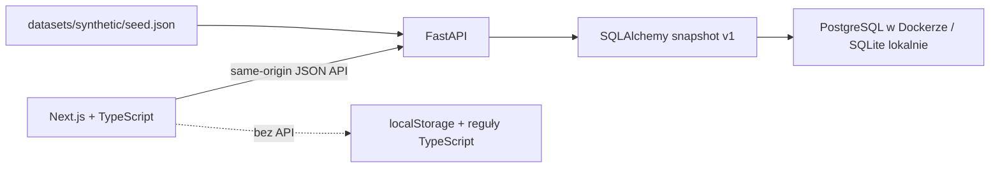

# Architektura

## Przepływ

Next.js tworzy statyczny eksport. Jeden proces FastAPI obsługuje API i pliki frontendu,
więc nie potrzeba CORS, serwera Node ani dodatkowego reverse proxy. Style CSS i ikony są lokalne;
aplikacja nie ładuje fontów, analityki ani skryptów z zewnętrznych serwisów.

## Trwałość i schema v1

`demo_state_v1` zawiera jeden rekord `id=1`, `payload JSON`, `revision INTEGER`.
Inicjalizacja idempotentnie tworzy tę tabelę i wczytuje fixture. To wersjonowany schemat demonstracyjny,
nie system migracji dla bazy produkcyjnej. Przyszłe zmiany schematu wymagają jawnej migracji przed wydaniem.
Aktualizacje korzystają z compare-and-swap po `revision`. Dwa zapisy tej samej rewizji nie nadpiszą się;
drugi dostaje HTTP 409, a UI wczytuje aktualny stan. Reset również zwiększa rewizję.

Ta świadoma redukcja modelu ułatwia reset i przenoszenie scenariusza. Docelowy system produkcyjny
powinien rozbić encje na tabele, dodać migracje, autoryzację, monitoring i polityki danych.
Redis/worker pominięto: reguły są synchroniczne i małe, nie ma długich operacji API ani zadań audio.

## API

| Metoda | Ścieżka | Zachowanie |
|---|---|---|
| GET | `/api/health` | Sprawdza również połączenie z bazą, zwraca `mode=demo` |
| GET | `/api/state` | `{data, revision}` |
| POST | `/api/reset` | Przywraca fixture, opcjonalnie `expected_revision` |
| GET | `/api/export` | Pobieralny JSON stanu |
| POST | `/api/conversations/{id}/analyze` | Przelicza regułową analizę jednej rozmowy, opcjonalna rewizja |

Każda mutacja zwraca `{data, revision}`. Pydantic odrzuca nieznane pola i błędne wartości.
Brak elementu: 404; niepoprawne dane: 422; konflikt: 409. UI pokazuje błąd zamiast udawać udany zapis.
W trybie przeglądarkowym dane są zapisywane wyłącznie w localStorage danej przeglądarki.

## Reguły domenowe

Analiza używa jawnych kryteriów: powitanie 20, empatia 25, kolejne kroki 35 (lub 10), zamknięcie 20. Zobowiązania rozpoznajemy po skończonym zbiorze polskich form pierwszej osoby. Zachowujemy ID segmentu i oryginalną frazę terminu, nie wyliczamy dat. Pewność 0.94/0.85 to umowna wartość reguły DEMO, nie skalibrowane prawdopodobieństwo. Status pozostaje unverified. Sentyment jest etykietą fikcyjnego scenariusza, nie diagnozą emocji. Przyszła integracja AI wymaga odrębnej decyzji i ewaluacji.

Backend Python i fallback TypeScript mają te same przypadki testowe. Test TypeScript porównuje wyniki analiz z fixture wyliczonym w Pythonie dla 20 rozmów.

## Dane

Zestaw jest w całości wygenerowany na potrzeby dema. IP używają zakresów dokumentacyjnych
192.0.2.0/24 oraz 198.51.100.0/24; to nie adresy infrastruktury użytkownika.
30 transkrypcji, 5 syntetycznych plików audio. Segmenty mają 13-sekundowe okna, nagrania zawierają celowe pauzy między wypowiedziami, aby czas zgadzał się z transkrypcją.
Brak połączeń z GCP, BigQuery, OpenAI API i danymi produkcyjnymi.
